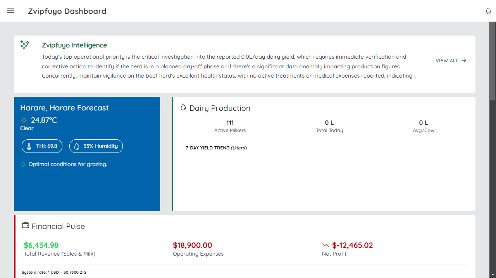
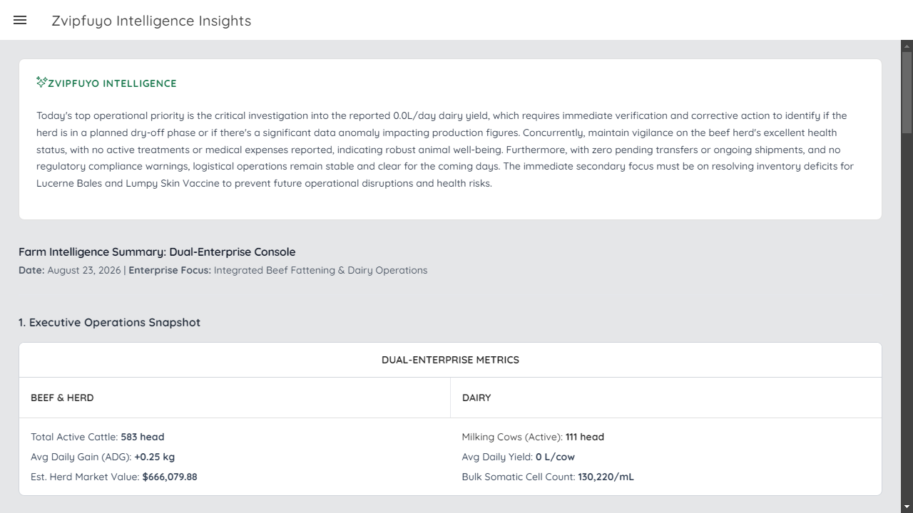
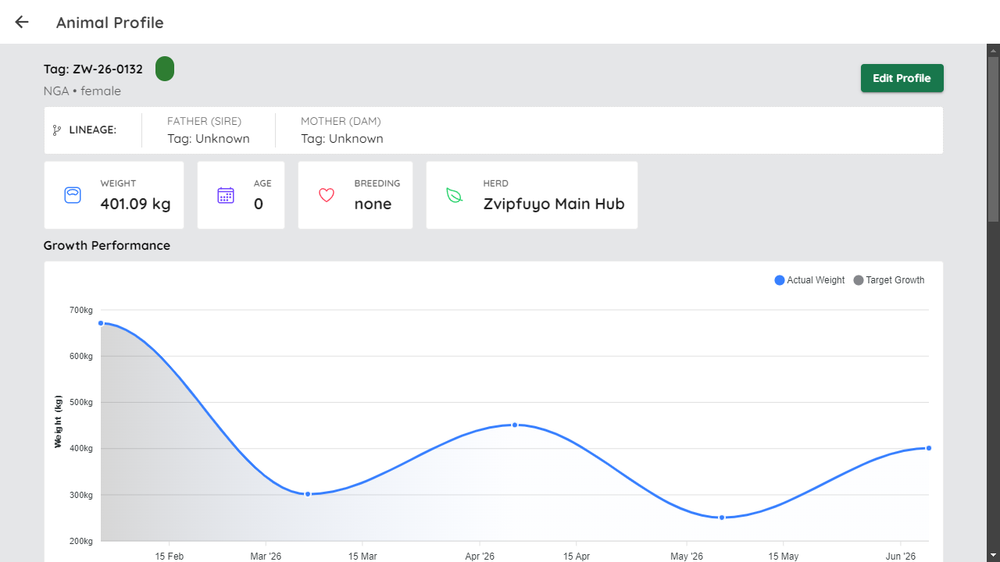
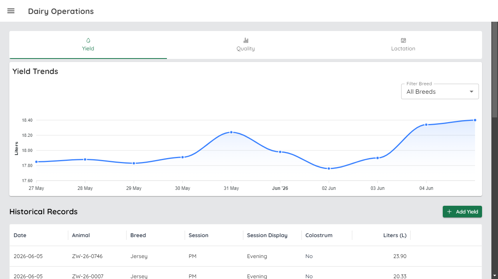
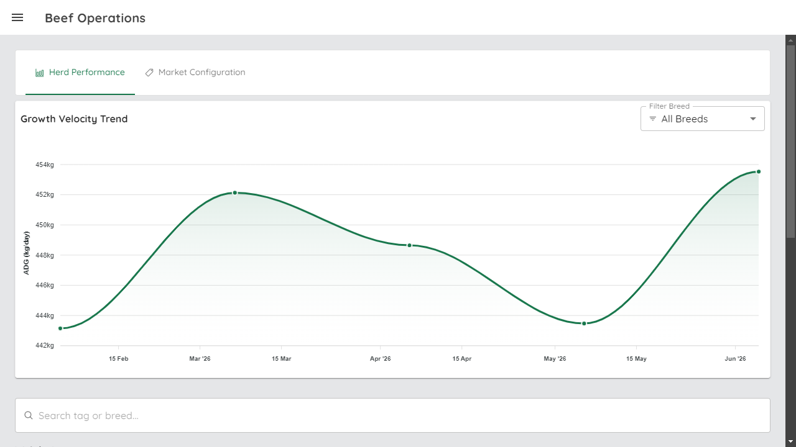
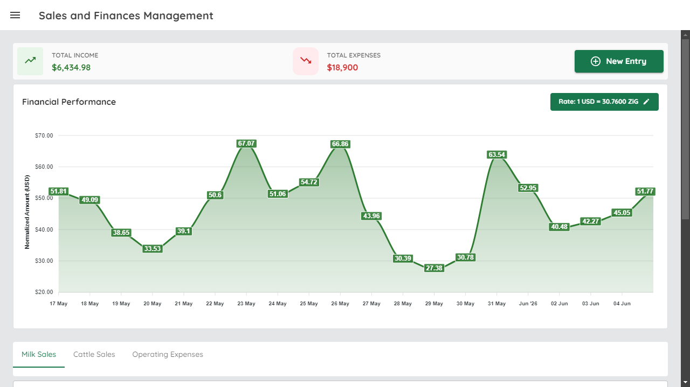
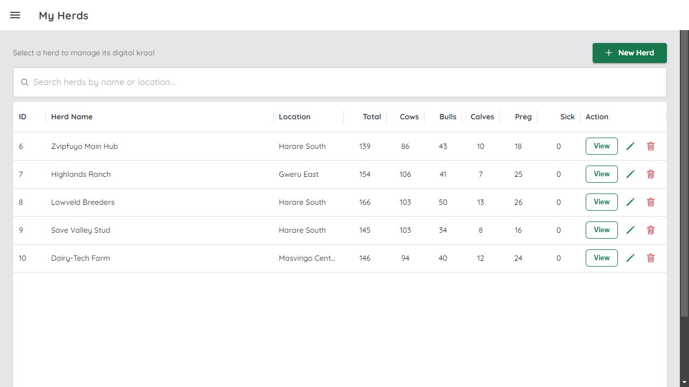

# Zvipfuyo — Livestock Management Platform

*Zvipfuyo* means "livestock" in Shona. It is a full-stack farm management platform for cattle operations in Zimbabwe: herd and animal records, dairy and beef production, health and breeding, inventory and procurement, finances, and AI-generated farm insights.

I designed and built the whole system myself — frontend, backend, data model and AI integration — without AI coding tools.

## Screenshots



| | |
|---|---|
|  **AI insights** — Gemini turns herd, dairy, inventory and weather data into a daily briefing |  **Animal profile** — lineage, weight, breeding status and growth history |
|  **Dairy** — yield trends by breed, plus quality and lactation tracking |  **Beef** — herd growth trends and market price configuration |
|  **Finance** — income, expenses and multi-currency (USD / ZiG) reporting |  **Herds** — herd composition across farms at a glance |

_Screens shown with simulated demo data._

**Repositories**
- Frontend (this repo): React + Ionic + TypeScript
- Backend: Django REST API — [zvipfuyo_backend](https://github.com/Mufaroe04/zvipfuyo_backend)

---

## What it does

| Area | Features |
|---|---|
| **Herd & animals** | Animal register with lineage (sire/dam), herd grouping, weight tracking and growth charts |
| **Dairy** | Milk yield, milk quality and lactation periods, with production charts |
| **Beef** | Herd performance, growth curves, market price configuration |
| **Health & breeding** | Treatment records, breeding events, pregnancy alerts |
| **Counting & transfers** | Manual and drone-assisted head-count audits, animal transfers between herds |
| **Inventory & supply chain** | Stock levels, stock history, purchase orders (sent to suppliers via WhatsApp), supplier directory |
| **Finance** | Sales and expenses, cattle and milk sales, multi-currency exchange rates, printable receipts |
| **Insights** | Dashboard modules plus AI-generated recommendations (Google Gemini) combining herd data with live weather |
| **Team** | Role-based access for owner, manager, farm hand and vet; tasks and notifications |

## Tech stack

**Frontend:** React 19, TypeScript, Ionic 8 + Capacitor (web and Android/iOS from one codebase), Redux Toolkit, MUI + MUI X Data Grid, ApexCharts / Chart.js, Axios, Vite

**Backend:** Django 6, Django REST Framework, SimpleJWT, PostgreSQL, Google Gemini API, OpenWeather API, Unfold admin

## Architecture highlights

- **Feature-based frontend.** Each area (`views/dairy`, `views/herd`, `views/finance`, ...) owns its pages, components and hooks. Data access sits in `services/`, shared state in Redux slices, so pages stay thin.
- **Layered backend.** Domain modules (`livestock_operations`, `production_analytics`, `supply_chain`, `finance_ledger`, `identity_access`, ...) are split into `domain`, `application` and `presentation` layers.
- **JWT auth with silent refresh.** An Axios interceptor retries failed requests after refreshing the access token.
- **Role-based access** enforced on both sides: menu items per role in the frontend, DRF permission classes in the API.
- **AI insights that degrade gracefully.** Farm data and weather are combined into a structured prompt; if the AI service is unavailable or not configured, the rest of the app keeps working.
- **24 data models** covering animals, production, health, inventory, procurement and finance.

## Running locally

**Backend** (see the backend repo for details)
```bash
python -m venv venv
venv\Scripts\activate          # Windows  (source venv/bin/activate on macOS/Linux)
pip install -r requirements.txt
copy .env.example .env         # then fill in DB credentials and optional API keys
python manage.py migrate
python manage.py createsuperuser
python manage.py runserver
```

**Frontend**
```bash
npm install
npm run dev
```
The frontend talks to `http://localhost:8000/api/` by default. Set `VITE_API_URL` to point at another backend.

## What I learned

I built Zvipfuyo expecting farmers to sign up. None did — and that taught me as much as the code did:

- **Validate before building.** I built 16 modules before talking to a single paying customer. Next time I start with one painful problem, a handful of real users, and a way to take payment.
- **Know who pays.** Smallholder farmers have little budget for software, and the government now offers a free digital livestock card. The people with budget are businesses that have money tied up in cattle: feedlots, lenders and insurers.
- **Production readiness is part of the product.** Secrets in environment variables, a clean deployment and automated tests matter as much as features.

## Roadmap

- Automated tests (DRF API tests, React component tests)
- Offline-first data entry for farms with poor connectivity
- Deployment with a public demo account
- Payments (Paynow / EcoCash) for a subscription model
